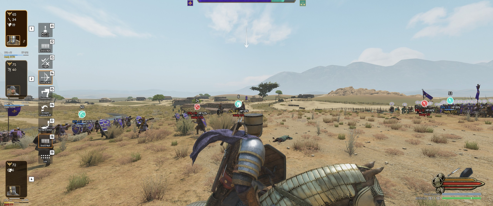
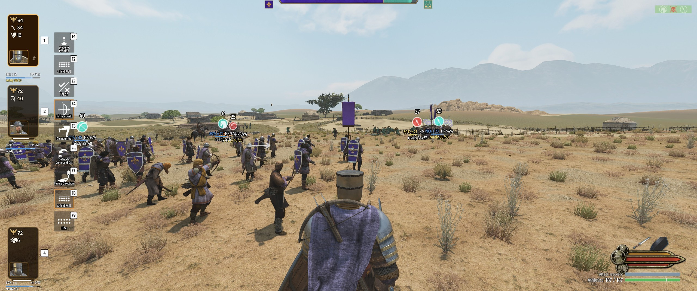

# Trax Combat Enhancements

**Men tire. Lines hold. A fresh charge at the right moment breaks them.**

A combat mod for Mount & Blade II: Bannerlord (v1.4.8): slower battles, where timing, rest and defence decide
the fight — and heroes matter.

## The idea

- **Men tire.** Every swing, kick and block costs stamina. A spent soldier attacks once where a fresh one
  attacks five times.
- **Tired men are careful, not brave.** They hold their place, block and wait for an opening — nobody trades
  blows until he drops.
- **An order makes them surge.** Call the charge and the line surges in with a fever that burns out as fast as
  their strength.
- **A shield wall holds.** Men keep their places; a man outnumbered pulls back to his mates instead of dying
  alone.
- **A fresh unit hitting a tired line throws men around** — staggered, knocked down, shields and riders knocked
  away.
- **Skill and timing decide the end of a long fight.** When both men are spent, every wrong block and every
  swing into a good guard counts.
- **Heroes matter.** They tire slowest; late in a battle they are often the freshest men on the field.

## How a battle plays

**Tiredness and rest.** Every fighter carries an Athletics bar — his stamina, as big as his Athletics skill.
Fresh, he fights as in the base game. Spent, he waits between attacks, runs at a jog, his lucky hits are
gone, and the AI starts guessing which way to block. Anyone can save a few swings and strike them back to
back. A minute of rest refills him — and a skilful defender recovers *while* he defends: clean blocks and
parries let the bar climb, a block on the wrong side stops it.

**Your orders and the fever of a charge.** Your order sets how hard your men fight: holding men stop swinging
early and save their strength behind their shields, advancing men give more, charging men give everything.
Order the charge and they surge — the line goes in eager, sprinting the last metres — and the surge fades as
the fever burns. A rested line hits hard and long; a tired one surges briefly. The charge is a moment to
choose, not a standing order.

**Holding the line.** A shield wall stays a wall: each man keeps his place and fights what reaches him, with one
short step out to strike. Men weigh the odds around them. The looter who wanders round your flank alone looks
at your wall, thinks better of it, and walks back to his mates; a crowd wraps round your wall only when it truly
outnumbers you there. Shaken men pack together; hopeless ones panic and run, and a routing man spends his whole
sprint on the get-away. Tired cavalry stops trickling in one by one: riders gather with their own kind and come
back as waves — small and often when fresh, the whole squadron at once late in the battle.

**Blows that count.** On a fresh man nothing changes. On a tired one a kick can knock his shield away or put him
on the ground, a hit can stagger him, a rider can be knocked from his saddle — and a man still reeling is easy
prey. A correct block punishes the attacker: swing tired into a good guard and *you* reel. A wrong-side block
punishes the defender. A man running into his blow hits harder, so hold a fresh shock unit back, wait until the
enemy line has fought for two minutes, and charge it into their flank at a run: men go down, shields fly, the
line folds. Into a fresh line the same charge only trades blows.

**Duels and tournaments.** A long bout is won by stamina and timing. The tournament champion who never misses a
block starts guessing when he is spent; your kick that bounces off a fresh king floors an empty one. Tire him
first, then break him. The hideout boss fight starts you both fresh.

**What you see.** Your Athletics bar under your health, your stored swings and your sprint above it. Hold ALT and
every formation — yours and the enemy's — shows its men's Athletics, health and how many are still *ready* to
fight; "ready 12/48" in red under an enemy marker is an invitation. The few men you look at get a small bar over
their heads. Hold Left Ctrl to sprint — a short dodge, paid from your stamina.

**Read more:** [the player guide](docs/HOW-IT-WORKS.md) — every system in plain words, with tactics — and
[the mechanics reference](docs/MECHANICS.md) — every table and number, and the setting behind each.

## Settings

It works out of the box. With the [Mod Configuration Menu](https://steamcommunity.com/sharedfiles/filedetails/?id=2859238197)
(**optional**) you get a short page — the master switch, how hard hits land, how fast men tire, each AI system's
own switch, staggers, the sprint and its key, what the screen shows — and an **Advanced** page with every other
number, for tuning. Without MCM the same settings sit in a commented config file
(`Documents\Mount and Blade II Bannerlord\Configs\TraxCombatEnhancements\config.json`). Every change applies at
once, even mid-battle; the master switch turns the whole mod off mid-fight, so you can play the same battle both
ways.

## Good to know

- **Not an overhaul.** Vanilla troops, weapons and AI — it changes how a fight feels, not what is in it. Nothing
  in your save: add or remove it mid-campaign.
- Game v1.4.8, singleplayer. No requirements, no Harmony. Works beside RTS Camera and War Sails.
- **Not with Realistic Battle Mod (RBM)** — the deep, much-loved overhaul with its own stamina. This is the light
  road on vanilla's troops; use one or the other (the mod warns at the main menu if it sees RBM).

## Install

1. Subscribe on the [Steam Workshop](https://steamcommunity.com/sharedfiles/filedetails/?id=3817259431) — or
   take the zip from the [GitHub release](https://github.com/TraxData313/trax_combat_enhancements/releases/latest)
   and extract it into `Mount & Blade II Bannerlord\Modules\`.
2. Enable **Trax Combat Enhancements** in the launcher.

Bugs, balance, a mod it fights with: [open an issue](https://github.com/TraxData313/trax_combat_enhancements/issues).
The mod keeps `trax_combat.log` beside its config file, with a summary of every battle — attach it.

Made by two of us: the code and all technical work by Claude (Opus 5.5), an AI; the idea, feedback and
playtesting by [Trax](https://github.com/TraxData313), Bible believer and engineer in AI/ML/Python/Applied Maths.

Free and open — public domain ([Unlicense](LICENSE)). Do whatever you like with it.
To thank me, open [my GitHub profile](https://github.com/TraxData313) and read my top pinned.

For developers — how it is built

- The full behaviour and every parameter: [docs/DESIGN.md](docs/DESIGN.md).
- Every number by system: [docs/MECHANICS.md](docs/MECHANICS.md); the impact system's design: [docs/IMPACT.md](docs/IMPACT.md).
- Verified game-API findings for v1.4.8: [docs/RESEARCH.md](docs/RESEARCH.md).
- How RBM paces battles, and the levers we chose from: [docs/BATTLE_PACING.md](docs/BATTLE_PACING.md).
- The playtest script and every log line: [docs/PLAYTEST.md](docs/PLAYTEST.md).
- The code reviews: [docs/REVIEW.md](docs/REVIEW.md).
- Progress: [TASKS_TODO.md](TASKS_TODO.md), [TASKS_DONE.md](TASKS_DONE.md).
- Build: `dotnet build -c Release`, `dotnet test -c Release`; deploy with `tools\deploy.ps1`, package with
  `tools\package.ps1`.
- Releasing: [tools/WORKSHOP-UPLOAD.md](tools/WORKSHOP-UPLOAD.md) — the thumbnail and gallery come from
  in-game screenshots via `tools/make_thumbnail.py` and `tools/make_gallery.py`.

